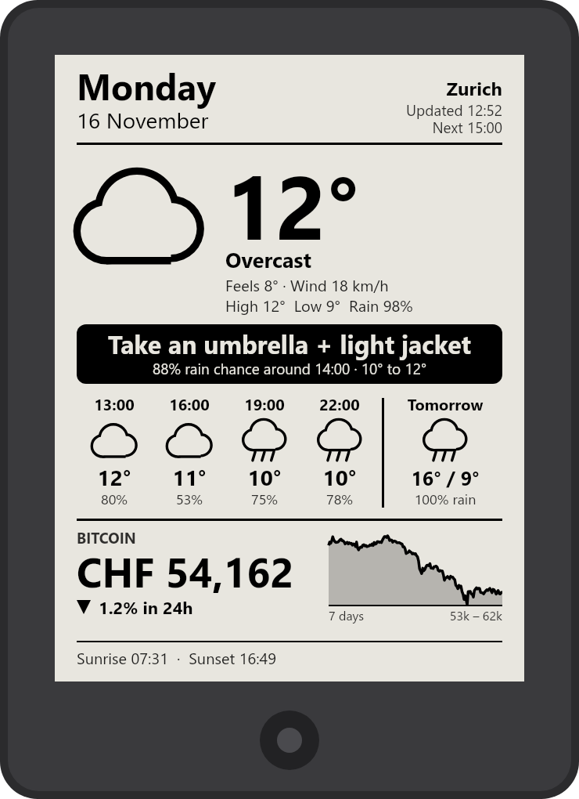
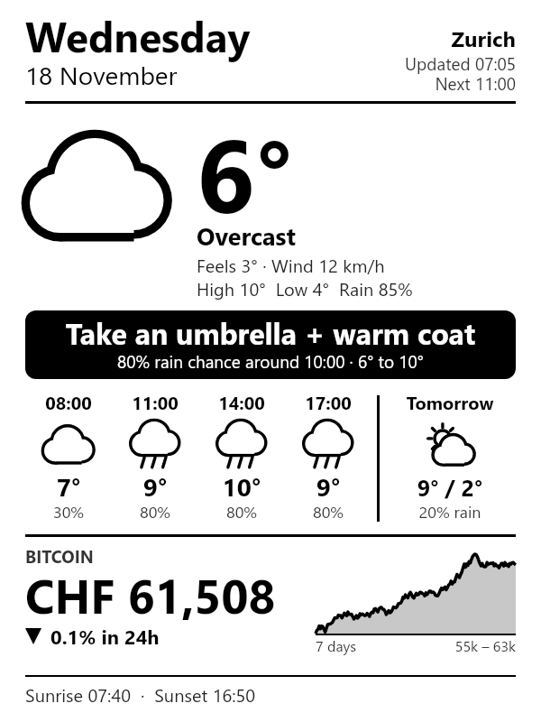
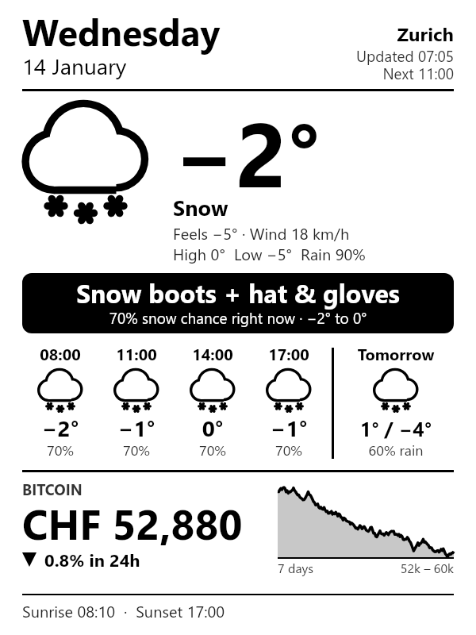
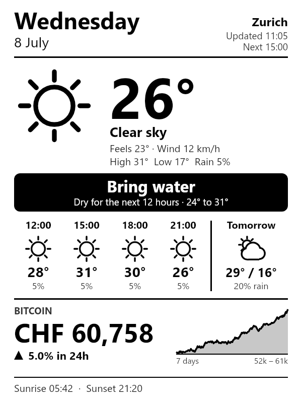
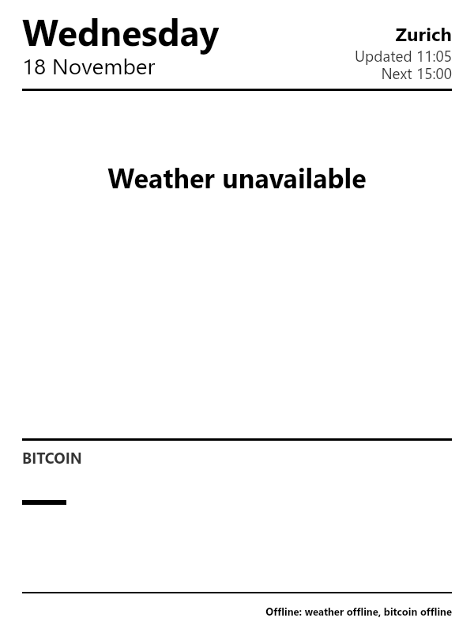

<p align="center"></p>

<h1 align="center">Doorstep</h1>

<p align="center"><b>An old Kindle, reborn as the e-ink display by your front door.</b><br>
Weather, what to bring, and Bitcoin, refreshed every 4 hours. No touch screen and no subscriptions needed, and the battery lasts for weeks.</p>

---

Doorstep turns an old non-touch Kindle (the one with buttons) into a screen you glance at on your way out. Every 4 hours it shows:

- **Weather now:** a big temperature, the conditions, feels-like, wind, and today's high, low and rain chance
- **What to bring:** a black banner with advice for the next 12 hours, such as *"Take an umbrella + warm coat"*
- **The day ahead:** forecasts in 3-hour steps, plus tomorrow
- **Bitcoin:** the price, the 24h change and a 7-day chart
- **Other details:** date, sunrise, sunset, and when the screen was last updated and will update next

| Rainy morning | Snow day | Summer afternoon | API down |
| :---: | :---: | :---: | :---: |
|  |  |  |  |

Regenerate these with `npm run demo`. It uses made-up data and needs no network, apart from the live mockup at the top.

There is no live clock on purpose. A screen that updates every 4 hours would show the wrong time most of the day.

## How it works

```
 Laptop (or GitHub Actions)                      Kindle (jailbroken)
 ─────────────────────────                       ───────────────────
 node src/server.js                              kindle-dash
   ├─ Open-Meteo  (weather, free, no key)          wakes at 03/07/11/15/19/23
   ├─ CoinGecko   (bitcoin, free, no key)   ◄────  downloads dashboard.png
   └─ draws 600×800 grayscale PNG                  shows it, then deep-sleeps
```

The Kindle doesn't run a browser. [kindle-dash](https://github.com/pascalw/kindle-dash), which was tested on the Kindle 4 non-touch, downloads one image and puts it on the screen. The Kindle then suspends until the next update, so the battery lasts a long time. You can also leave it on USB power.

If a data source is down, the server still sends an image. It reuses the last good data and prints `Offline: …` in the bottom-right corner, so the screen never goes blank.

---

## 1. Run the image server

You need [Node.js](https://nodejs.org) 18 or newer.

```bash
npm install
```

Edit `config.json`:

| key | meaning |
| --- | --- |
| `city` | City name used to look up the weather location. You can also set `latitude` and `longitude` for an exact spot |
| `timezone` | e.g. `Europe/Zurich`, `Europe/Berlin`, `Europe/Rome` |
| `currency` | `chf`, `eur`, `usd`, … |
| `refreshHours` | Must match `REFRESH_SCHEDULE` on the Kindle. It's only used to print "Next 11:00" |
| `port` | HTTP port, default `8080` |

Render a test image to `out/dashboard.png`, or run `npm run demo` to render the example screens:

```bash
npm run render
```

Start the server:

```bash
npm run serve
```

Open <http://localhost:8080/> to preview it. The Kindle downloads `http://<laptop-ip>:8080/dashboard.png`.

### Running it on the old laptop

Do these once, from PowerShell as administrator:

1. **Allow the Kindle through the firewall:**
   ```powershell
   New-NetFirewallRule -DisplayName "Kindle dashboard" -Direction Inbound -Protocol TCP -LocalPort 8080 -Action Allow -Profile Private
   ```
2. **Stop the laptop from sleeping on AC power.** The lid-close action is under *Control Panel → Power Options → Choose what closing the lid does*.
   ```powershell
   powercfg /change standby-timeout-ac 0
   ```
3. **Give the laptop a fixed IP.** Set a DHCP reservation in your router so the address in `fetch-dashboard.sh` keeps working.
4. **Start the server automatically.** Press `Win+R`, type `shell:startup`, and put a shortcut to `start-server.cmd` in that folder.

### Alternative: no computer at home (GitHub Pages)

1. Push this folder to a GitHub repo.
2. Go to **Settings → Pages → Source: GitHub Actions**.
3. Run the *Render Kindle dashboard* workflow once by hand.

The workflow `.github/workflows/render.yml` renders the image 20 minutes before each Kindle wake-up. It publishes the image at `https://<user>.github.io/<repo>/dashboard.png`, and kindle-dash's `xh` handles HTTPS.

Caveats:
- GitHub pauses scheduled workflows in repos with no activity for 60 days.
- CoinGecko sometimes rate-limits GitHub's shared IPs. The Bitcoin panel then shows "offline" for that update.

---

## 2. Prepare the Kindle

> kindle-dash is built for the **Kindle 4 non-touch** (it wakes the device through that model's clock chip). A Kindle Keyboard or a later non-touch model may need small changes in `dash.sh`.
>
> The jailbreak depends on your exact model and firmware. Look these up first: on the Kindle, go to **Menu → Settings** and read the version at the bottom of the page. Follow the jailbreak thread for that model on the [MobileRead Kindle Developer's Corner](https://www.mobileread.com/forums/forumdisplay.php?f=150). Don't use random YouTube guides.

1. **Jailbreak the Kindle.** Then install **KUAL**, the app launcher, as described in the same MobileRead threads.
2. **Connect it to your Wi-Fi** through the normal Kindle settings.
3. **Download the kindle-dash release.** Get the latest **release tarball** from <https://github.com/pascalw/kindle-dash/releases>. The repo source is missing the prebuilt `xh` and `next-wakeup` ARM programs, so it won't work.
4. **Copy the files over USB.** The Kindle shows up as a USB drive.
   - Copy the release's files into a folder named `dashboard` on the drive. The Kindle sees it as `/mnt/us/dashboard`.
   - Replace `dashboard/local/env.sh` and `dashboard/local/fetch-dashboard.sh` with the two files from this repo's `kindle/local/`.
   - Copy the release's `KUAL/kindle-dash` folder into `extensions/` on the drive.
5. **Set the image address.** Edit `dashboard/local/fetch-dashboard.sh` and set `DASHBOARD_URL` to your laptop's IP or your GitHub Pages URL.
6. **Start the dashboard.** Eject the drive, open **KUAL → kindle-dash**, and start it. The dashboard appears and the Kindle goes to sleep about 10–15 seconds later.

**To exit:** hold the power button until the Kindle restarts. After a restart it boots back to the normal Kindle.

### Settings already set in `kindle/local/env.sh`

| setting | value | why |
| --- | --- | --- |
| `REFRESH_SCHEDULE` | `0 3,7,11,15,19,23 * * *` | Every 4 hours, with one update at 07:00 before you leave. Change the hours to fit your routine |
| `SLEEP_SCREEN_INTERVAL` | `20000` | **Required.** At the default of 3600, any gap longer than 1 hour shows kindle-dash's "sleeping" image instead of your dashboard |
| `FULL_DISPLAY_REFRESH_RATE` | `1` | A full refresh on every update clears e-ink ghosting. The flash is fine at 6 updates a day |

## Without a jailbreak (fallback)

Open `http://<laptop-ip>:8080/` in the Kindle's **Experimental Browser**. The page reloads every 4 hours. However, the stock screensaver takes over after a few minutes. Some older firmware lets you turn it off by typing `~ds` in the search box. It works as a test, but the jailbroken setup above is what you want next to the door.

## Mounting tips

- Hang it at eye level, in portrait. The layout is designed for the native 600×800 portrait screen.
- A small USB charger behind it means you never have to take it down to recharge.

---

## Project layout

```
config.json                 city, timezone, currency, refresh hours
src/render.js               draws the 600×800 dashboard (also a CLI)
src/data.js                 Open-Meteo + CoinGecko, with a last-good-data cache
src/icons.js                weather icons drawn with thick strokes for e-ink
src/png.js                  tiny 8-bit grayscale PNG encoder (what eips wants)
src/server.js               HTTP server: /dashboard.png and a preview page
src/demo.js                 example screens + device mockup for the README
kindle/local/               kindle-dash settings to copy onto the Kindle
.github/workflows/          optional: render on GitHub Actions → GitHub Pages
```

## Build it yourself with an AI coding agent

This project was built in one conversation with [Claude Code](https://claude.com/claude-code). If you want your own version, in a different city, with other data, or with your own design, give these prompts to an AI coding agent one at a time. Check the result after each one.

**1. The idea and the hardware**
```text
I have an old non-touch Kindle (the version with buttons) and an old laptop.
I want to turn the Kindle into an always-on display for the entrance of my
apartment. It should show useful things for when I leave home, such as the
weather and the Bitcoin price, and refresh by itself every 4 hours. Choose
what's best for an entrance and explain the architecture before you build it.
```

**2. The renderer**
```text
Build a Node.js renderer that draws a 600x800 portrait dashboard and saves it
as an 8-bit grayscale PNG with no alpha channel, because that's what the
Kindle's eips tool needs. Use free APIs that need no key: Open-Meteo for
weather and CoinGecko for Bitcoin. Show the date, current weather with a big
temperature, a black banner with advice on what to bring for the next 12 hours
(umbrella, coat, gloves...), a forecast in 3-hour steps plus tomorrow, and the
Bitcoin price with its 24h change and a 7-day chart. Use large type, thick
lines and hard black and white, since it's e-ink. Don't show a live clock.
Show "Updated HH:MM · Next HH:MM" instead.
```

**3. Make it robust**
```text
Make the image always render, even when an API is down: cache the last good
data on disk, use it, and mark it as offline in the footer. Then add a small
HTTP server that serves /dashboard.png with a 200 status, plus a preview page.
Verify the PNG header yourself: 600x800, bit depth 8, colour type 0.
```

**4. The Kindle side**
```text
Set up the Kindle with kindle-dash (github.com/pascalw/kindle-dash). Write
local/env.sh and local/fetch-dashboard.sh for a refresh every 4 hours that
includes 07:00, my timezone, and a full e-ink refresh on every update.
Check kindle-dash's source for settings that would break a 4-hour schedule,
such as SLEEP_SCREEN_INTERVAL. Write setup steps that point to the MobileRead
jailbreak thread for my model and firmware instead of guessing them.
```

**5. Hosting**
```text
Give me two hosting options: (a) the old laptop, with the Windows firewall
rule, power settings and auto-start, and (b) a GitHub Actions workflow that
renders the image shortly before each Kindle wake-up and publishes it to
GitHub Pages, so no computer at home has to stay on.
```

**6. Personalise**
```text
Set the city to <your city>, the timezone to <your timezone> and the currency
to <your currency>. Add a demo script that renders example screens (rainy,
snow, summer, offline) from made-up data for the README, plus a mockup of the
display in an e-reader frame.
```

Ideas for your own version: public transport departures from the nearest stop, a bin collection reminder, your calendar's first meeting, or the indoor temperature from a smart home sensor.

## Credits

- [kindle-dash](https://github.com/pascalw/kindle-dash) by Pascal Widdershoven, which runs on the Kindle
- [Open-Meteo](https://open-meteo.com) for the weather data and [CoinGecko](https://www.coingecko.com) for the Bitcoin data
- The [MobileRead](https://www.mobileread.com/forums/forumdisplay.php?f=150) community for Kindle jailbreaks

Not affiliated with Amazon. Kindle is a trademark of Amazon.com, Inc.

## License

[MIT](LICENSE)
